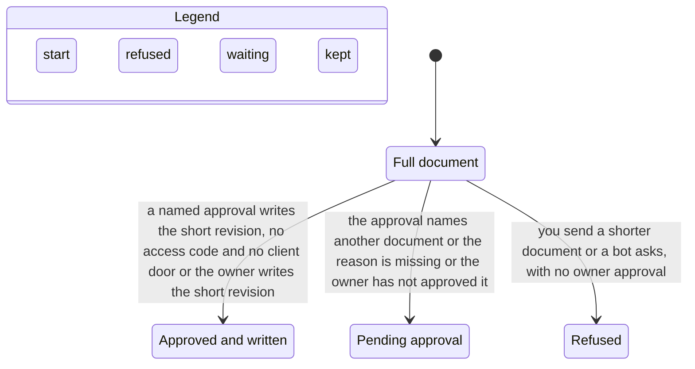

# Condensing a document

A write that leaves a document under half the size this session first saw is refused (`EMET-DOC-025`). Nothing is written. That floor is the default.

The owner door can write the shorter revision when the call passes `condense_approved` true and a reason. A caller who is not that door can do the same when `writer_approval_id` names a writer approval the owner has already granted for that caller and for that document. A grant with no document, or a grant for another document, is not a condense permit. A bot tag, including the hub and any `hubbot-*` tag, is still refused on the owner password. A sub-key or a key door without an approval for this document is still refused. A missing reason, or an approval the owner has not granted, is `EMET-DOC-090` and writes nothing.

The prior revision stays in `documents_history`, byte for byte. The new revision stores the reason, the approver, the prior size and digest, and the new size and digest. The episodic note is written only after that revision is read back, and the audit log records the same facts. `archive_doc` is optional. When it is set, the revision names that copy. The history row is the retained prior text either way.

ISO 9001 7.5.3 / ISO 13485 4.2.5: the record is superseded, the prior copy is marked obsolete, and the prior copy is retained. Nothing is deleted.

The chart hides the step that stays on Refused, on Pending approval, and on Approved and written. Those are ends. A write that is not under half is not this chart.

The model is `verification/condense-approval/CondenseApproval.tla`. TLC 2.19 found 115 distinct states. The depth of the complete state graph is 2. No error. `TypeOK`, `NoWriteWithoutFlag`, `NoWriteWithoutReason`, `HistoryKept`, `PriorStays`, `PendingWritesNothing`, `RefusedWritesNothing`, `ApprovedIsWritten`, `StartUnwritten`, `OwnerOrThisDoc`, `BotNeedsThisDoc`, `BotPasswordIsNotEnough`, `MemberNeedsThisDoc`, `OtherDocWritesNothing`, `NoWriteForOtherDoc`, and `FlagOffIsRefusal` hold. A writer approval condenses only the document it names. The owner password does not make a bot tag the owner. The run is `verification/condense-approval/tlc-output.txt`. CI runs this model from `scripts/tlc.sh`.

A record such as `HANDOFF.md` still needs `supersedes` and a reason of at least 10 characters. That reason is the condense reason. The same door skips the 24 hour peak floor (`EMET-DOC-026`) only when this approval is granted. Without the flag, both floors are unchanged.
