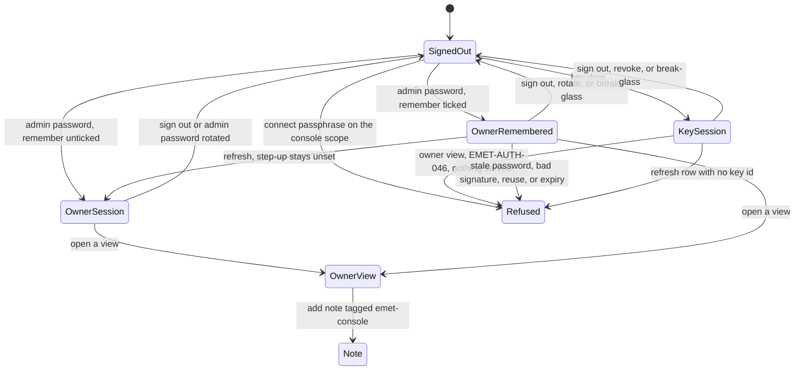

# EMET Console

The console is a separate app. The owner signs in with the admin password. A key signs in through the key door and cannot open an owner view. Remember this phone is off unless the person ticks it on the server's own sign-in page. The same diagram is served at `/statechart`.

The connect passphrase does not open the console. The admin password does. A console token carries scope `emet.console` and is bound to that server's `/console/api`. It is refused on `/mcp`. An MCP token is refused on `/console/api`.

Remember this phone stores one refresh row for that phone on that server: the door, the admin-password version or the key id, the device id, the device public key, and a hash of the refresh token. The refresh token itself is not stored. Each refresh is signed by the device key, rotates the token, and re-checks the password version or the live key. A refused refresh deletes the row. A key-door row with no key id is refused and deleted. Refresh never sets step-up.

A note is `save_to_layer` through `dispatch.js`. The source is `emet-console`. STATE.md and HANDOFF.md are read-only. Phase 1 mints no key, invite, or approval.

Sign out, admin-password rotation, key revoke, and `/owner/break-glass` delete the console session and the refresh row together.

## Rules

| Rule | What it holds |
|---|---|
| ConsoleIsOwnerOnly | An owner view is served only for an owner session whose admin-password version is current. |
| KeySessionCannotReachOwnerViews | A key session never becomes an owner view. |
| NoConsoleAfterLogoutOrRotate | After sign-out or password rotation the owner view is gone. |
| ConsoleWriteAttributed | A console note is tagged `emet-console` and written by the owner. |
| ConsoleNeverMintsAccess | Phase 1 mints no key, invite, or approval. |
| PrivilegedActionRequiresStepUp | A privileged action requires a password step-up. Phase 1 performs none. |
| RevokeTakesEffectImmediately | Revoking a key deletes its console token and its refresh row in the same step. |
| RememberIsOptIn | A refresh row exists only after the remember box was ticked. |
| StepUpOnlyByPassword | Step-up is unset, or it was opened by the admin password. Refresh never opens it. |
| NoOwnerRefreshAfterRotate | An owner refresh row still present carries the current admin-password version. |
| SessionNeedsLiveCredential | An owner session matches the current password version. A key session names a live key. |
| LogoutEndsRemember | After sign-out there is no session and no refresh row. |
| ServerIsolation | A request for a server uses only the token that server issued. |
| TokenBoundToIssuer | A token is refused by any server that did not mint it. |
| NoMixedViews | The screen shows one server. Switching servers clears it. |

The executable picture is `src/console-statechart.js`. The model is `specs/tla/EmetConsole.tla` with `EmetConsole-phase1.cfg`. Server isolation is `specs/tla/EmetConsoleServers.tla`.
