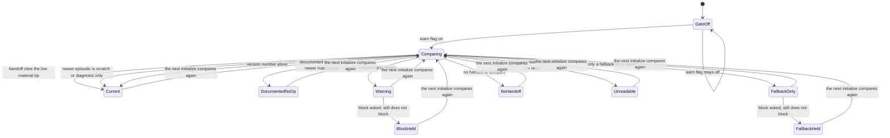

# Continuity currency

The warn-only comparison of the served handoff with the material episodic tip. `EMET_CONTINUITY_CURRENCY` is off unless it is `1`. A lag warns. The server does not rewrite HANDOFF or STATE, and it does not block the call. `EMET_CONTINUITY_CURRENCY_BLOCK` is reserved and is not applied.

The model is `verification/continuity-currency/ContinuityCurrency.tla`, with `ContinuityCurrency.cfg`. TLC does not enumerate episodic ids. `newer` and `claim` are classes. `fallback` is a logged tip: it warns, and it is not block-eligible. No handoff and an unreadable comparison are phases. The executable check is `continuityCurrencyStep` in `src/continuity-currency-statechart.js`. TLC on this revision found 16 distinct states. The depth of the complete state graph is 4. No error. `TypeOK`, `NeverRewrites`, `NeverBlocks`, `WarnOnlyOnMaterialLag`, `FlagOffShowsNothing`, `NoOpIsNotAWarning`, `NoHandoffIsQuiet`, `UnreadableIsQuiet`, `FallbackOnlyIsNotBlockEligible`, `ScratchIsNotAWarning`, and `VersionAloneDoesNotWarn` hold. The run is `verification/continuity-currency/tlc-output.txt`.

The generated chart draws 10 states and 17 arrows. It joins the three Comparing to Current reasons onto one arrow, and it omits the step that stays in Gate off, the warn flag staying off. This diagram draws that step and keeps the three reasons separate. No handoff, unreadable, and fallback-only are on both.

When `EMET_TAG_HANDOFFS` is `warn` or `enforce`, the same gate is read per tag. An open session with material work is an in-progress line on the handoff view. It is not a lag. After `EMET_STALE_OPEN_HOURS` (default 24) that line is marked stale-open. The overall status is the worst status among the tags that count. A `no_handoff` tag with no material episodic rows at or after the cutoff stays on the per-tag list and is left out of that overall status. A tag with material rows at or after the cutoff, or with no readable timestamp, and no handoff still counts. While the flag is `warn` or `enforce`, `legacy_pre_attribution` is on every reading. The cutoff is the start of the UTC day 2026-09-27 (`2026-09-27T00:00:00.000Z`). A row at or after that instant with no registered source still warns. `does_not_block` stays true. No setting refuses the call. The picture for that protocol is [per-tag-handoff-statechart.md](per-tag-handoff-statechart.md).
