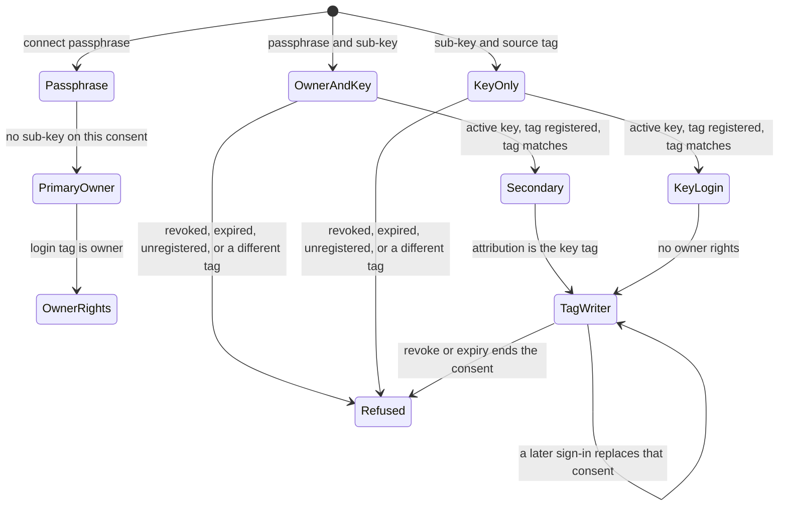

# Key sign-in

A bot, a member, or a guest signs in with a sub-key and the source tag on that key. A secondary owner signs in with the connect passphrase and a sub-key. The primary owner signs in with the passphrase. The same diagram is served at `/statechart`.

The passphrase consent carries no sub-key. Its login tag is `owner`. Owner rights stay on that consent. A sub-key presented later on that login does not move the login tag.

The passphrase-and-key consent and the key-only consent grant a writer for the key's tag when the key is active, the tag is registered, and the posted tag is the tag on the key. The stamp is that tag. Those consents have `emet.read` and `emet.write`. They do not have owner rights.

A revoked key, an expired key, a tag that is not registered, a posted tag that differs from the key, and a missing key are refused with `EMET-AUTH-046`. Nothing is granted. The message names the tag that failed. An empty post grants nothing.

A granted key consent is bound to that key id. One key has one live consent. A later sign-in for the same key replaces the previous consent. Revoke and expiry close it. A write after that is refused, and a refresh is refused.

## State table

`signIn` is the consent. `key` is `active` only when the key is unrevoked, unexpired, the tag is registered, and the posted tag matches. The passphrase consent and an empty post pair with `none`.

| signIn | key | role | owner rights | attribution | granted |
|---|---|---|---|---|---|
| passphrase | none | primary | yes | owner_login | yes |
| owner_key | active | secondary | no | key_tag | yes |
| owner_key | revoked, expired, unregistered, mismatch, or none | refused | no | none | no |
| key_only | active | key | no | key_tag | yes |
| key_only | revoked, expired, unregistered, mismatch, or none | refused | no | none | no |
| absent | none | refused | no | none | no |

The executable check is `keyDoorOutcome` in `src/key-door-statechart.js`. It walks the same fourteen rows.

The model is `verification/key-door/KeyDoor.tla`. TLC 2.18 on this revision found 29 distinct states. The depth of the complete state graph is 4. No error. `TypeOK`, `KeyOnlyNeverOwner`, `SecondaryNeverOwner`, `KeyAttribution`, `PrimaryUnchanged`, `BadKeyRefused`, `NoWriteAfterRevoke`, and `OneLiveConsent` hold. One state is the start. The sign-in table is 14 rows. Revoke, expiry, replace, and write are the later steps. A write is recorded only while the consent is live. The run is `verification/key-door/tlc-output.txt`.
