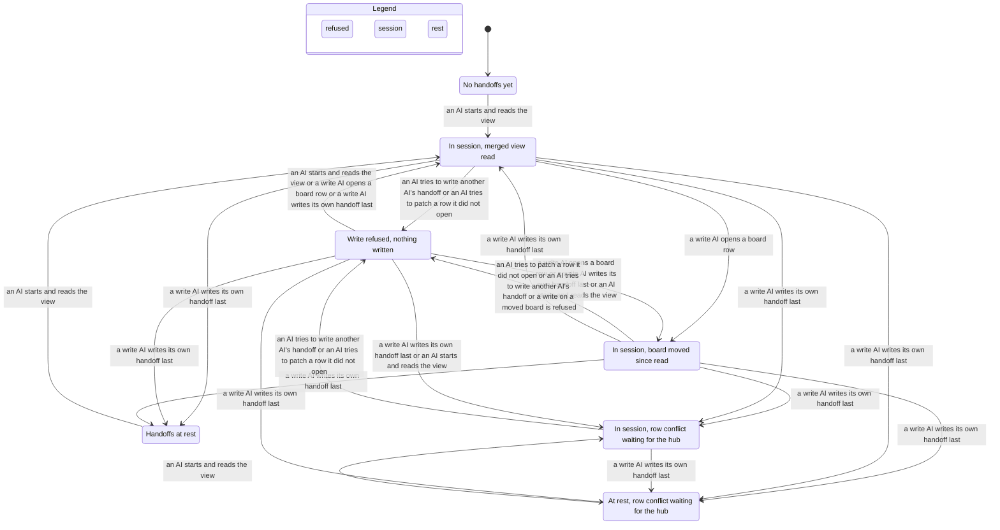
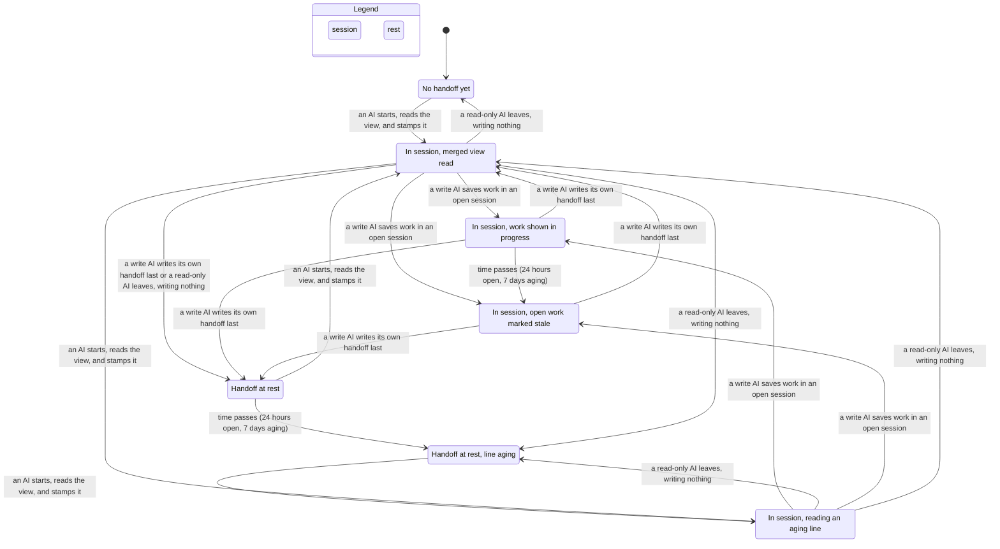
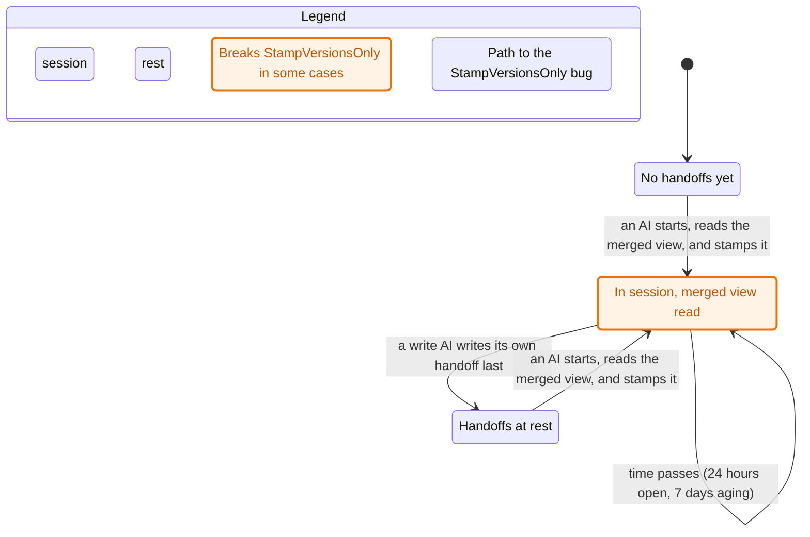

# Per-tag handoff statechart

`EMET_TAG_HANDOFFS` is off unless the value is `warn` or `enforce`. Off is the default. Both pictures are also on `/statechart`. The executable steps are `perTagHandoffStep` in `src/per-tag-handoff-statechart.js`.

The reference model is `verification/per-tag-handoff/PerTagHandoff.tla`, with `PerTagHandoff.cfg`, `view.mjs`, and `StampCounter.cfg`. TLC 2.19 found **958,557 distinct states** (8,532,898 generated), search depth 20, no error. `TypeOK`, `OwnHandoffOnly`, `RowPatchedOnlyByOpener`, `NoLostBoardUpdate`, `ReadOnlyWritesNothing`, `IdsCarryPerson`, `OpenWorkOnlyInProgress`, `StaleMarkOnlyWhileOpen`, and `StampReproducible` hold. The run is `verification/per-tag-handoff/tlc-output.txt`. That model is too big to draw: the chart budget is 500 states.

`StampCounter.cfg` checks `StampVersionsOnly` instead, a stamp of versions without the as-of age. It breaks in four steps: an AI starts, a write AI writes its own handoff, another start reads the view, then time passes and the line is aging. The path is `verification/per-tag-handoff/out-counter/`. The product stamp carries `as_of` so the same inputs rebuild that class.

The earlier draft, before the locked decisions, is `verification/per-tag-handoff/v1-draft/`. TLC on that draft found 187 distinct states. It does not have the opener rule, the person segment, or the as-of stamp.

The pictures below are drawn from a split of the reference, each inside the 500-state budget. The conflict module has no clock. The time module has no board. The full model checks both together, including a read-only tag trying to write another handoff. The time picture hides that refusal attempt. Both pictures hide a finish that stays in the same label.

Conflict: `verification/per-tag-handoff/split/PerTagConflict.tla`. TLC found 138 distinct states. The chart draws 7 states and 20 arrows.

Time: `verification/per-tag-handoff/split/PerTagTime.tla`. TLC found 143 distinct states. The chart draws 7 states and 19 arrows.

The counter-check draws only the path that breaks `StampVersionsOnly`:

What the reader can check:

- A tag patches a board row it opened. The hub changes another tag's row only when that row is marked in conflict.
- A bot tag may patch its own rows. It still cannot write the hub handoff.
- Each write tag writes its own handoff. Another tag's handoff is refused.
- A read-only tag writes nothing.
- An open session with material work is an in-progress line. It is not a pointer and it is not a lag. After the long tick it is stale-open, and only while that session is still open. Nothing here blocks.
- A handoff line ages after the long tick. The stamp records the age it was read at, so the view can be rebuilt. A stamp of versions alone cannot.
