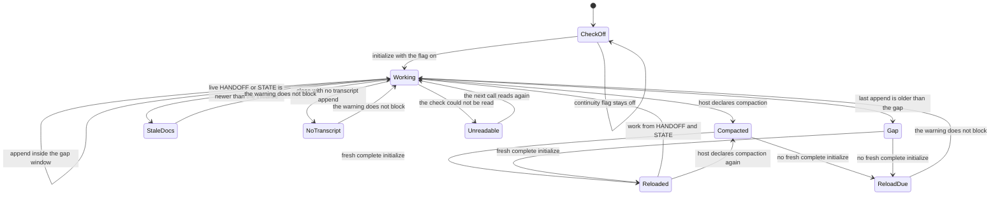

# Reload after compaction

A host's chat summary is not the continuity record. After any compaction or summary, and before multi-step work, the host re-runs `emet_initialize` for every page and works from HANDOFF and STATE. The rule is on every initialize, in `reload_after_compaction`, in `page_notice`, and in the tool descriptions. The checks run when `EMET_CONTINUITY_CURRENCY` is `1`. A skipped reload warns and does not block. HANDOFF and STATE are not rewritten. Nothing is deleted. The same diagram is served at `/statechart`.

The warn flag is `EMET_CONTINUITY_CURRENCY`. It is off unless the value is `1`. While it is off, initialize still carries the rule and `reload_after_compaction.status` is `off`. Session open, append, close, and other writes add no reload report.

With the flag on, initialize records the HANDOFF and STATE version and sha256 it served. That record lives in this process, for 60 minutes, beside the startup page cache. It is not a document. A redeploy or a restart drops it, and the next call warns until the host re-runs `emet_initialize`. A content-hash `load_id` does not by itself prove a reload: the same payload hashes the same. Freshness is the time that complete initialize was served.

A host declares compaction with `compacted: true`. `after_compaction: true` is the same flag. Pass the `load_id` from the initialize that followed the compaction. A complete initialize served within `EMET_RELOAD_FRESH_MINUTES` (default 15) is fresh. A compaction without that fresh initialize warns. The call still returns.

A session whose previous transcript activity is at least `EMET_RELOAD_GAP_HOURS` old (default 6) warns, unless the call carries a fresh complete `load_id`. The exchange just written is not the gap. A first append has no prior activity. An invalid or non-positive setting stays on the default.

A write whose initialize saw a different HANDOFF or STATE version, or a different sha256, warns. The notice names both versions. The server does not rewrite either document. A missing seen version does not warn. A check that cannot be read is `unreadable` and does not warn.

A close whose transcript has no exchanges warns, and the same sentence is listed under `warnings`. The close state stays what the receipts decide. The transcript is not deleted.

`does_not_block` is true on every report. `block_enabled` is false. `EMET_CONTINUITY_CURRENCY_BLOCK` is reserved and is not applied. Setting it does not block.

The executable check is `reloadAfterCompactionStep` in `src/reload-after-compaction-statechart.js`. `handoffMutated`, `stateMutated`, `deleted`, and `blocked` stay false.
