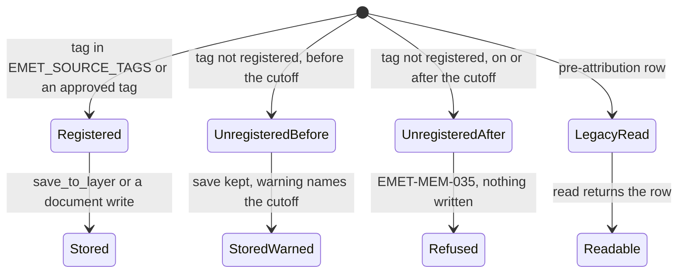

# Unregistered source saves

A save names a source tag. The tag is registered when it is an exact member of the list `emet_transcript_append` already uses: `EMET_SOURCE_TAGS`, plus a tag approved in `emet/CLIENT_APPROVALS.md` once that record is loaded. A sub-key stamps the tag bound to that key. An owner-door write stamps the tag bound at approval. Those writes are registered when that tag is on the list. The same diagram is served at `/statechart`.

Before the cutoff an unregistered save is stored. The receipt warning names the cutoff date and `America/New_York`. A layer row still carries `source_unregistered`. On the cutoff date, and after it, the save throws `EMET-MEM-035` before the insert, the archive, or a staged begin. The message says nothing was written. The registry is not listed.

The cutoff is the civil date `EMET_SOURCE_SAVE_CUTOFF` in `America/New_York`. Unset, blank, or a value that is not `YYYY-MM-DD` stays `2026-12-15`. `CASCADE_SOURCE_SAVE_CUTOFF` is the fallback when the EMET name is unset. The check is the shape `YYYY-MM-DD` only. It does not check that the month and day are a real date. The process time zone is not this clock. `2026-12-15T04:59:59.999Z` is still 14 December in New York. `2026-12-15T05:00:00.000Z` is the cutoff instant in Eastern Standard Time. A clock that cannot be formatted stays before the cutoff, so the save is not refused.

No registry configured is open. Any tag is stored and this warning is not added. A save with no source tag stays `source_missing`, or takes `EMET_SOURCE_TAG` when that default is set. This cutoff does not refuse a missing tag. A default that is not on the list is unregistered.

A document write that already refuses an unregistered source with `EMET-DOC-020` still refuses it. The cutoff does not open that door. A new drop, a bot folder the registry check still allows, `retire_doc`, and `accept_nonconformance` use this gate. `save_to_layer` and `revise_memory` use it. Transcript appends stay an immediate refusal (`EMET-TOOL-004`). The board guard is unchanged.

A row already stored stays readable. That includes a legacy pre-attribution row with no source. `query_layer`, `recall`, and `read_doc` do not run this gate and do not rewrite the row.

## State table

`phase` is `before` or `on_or_after`. It is read only for an unregistered save. `legacy` is a read of a row already stored.

| membership | phase | outcome | stored | warned | refused | code |
|---|---|---|---|---|---|---|
| registered | before or on_or_after | stored | yes | no | no | |
| open | before or on_or_after | stored | yes | no | no | |
| absent | before or on_or_after | stored | yes | no | no | |
| unregistered | before | stored_warn | yes | yes | no | |
| unregistered | on_or_after | refused | no | no | yes | EMET-MEM-035 |
| legacy | before or on_or_after | legacy_readable | no | no | no | |

The executable check is `sourceSaveOutcome` in `src/source-save-statechart.js`. It walks the same ten rows: five memberships and two phases. `open` is no registry. `absent` is no source tag. `legacy` ignores the phase.
