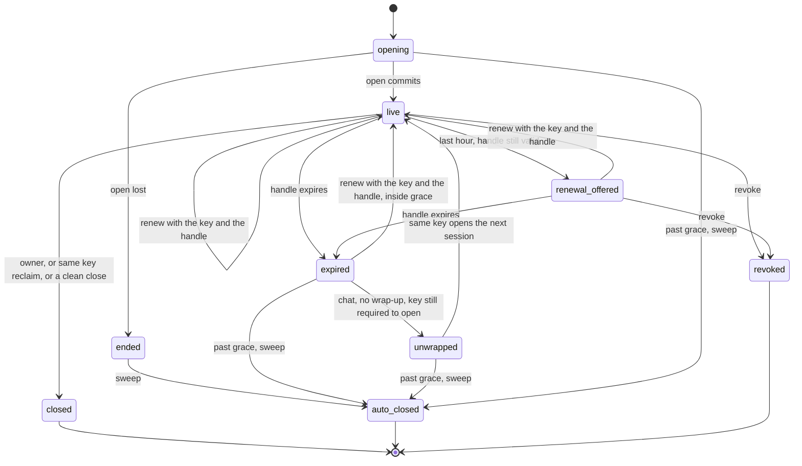

# Sub-key session

A sub-key has one live session. The handle lasts 12 hours. The last hour is the renewal window. The hour after expiry is the grace window. Past that, or when the link is already ended, the sweep records `auto_closed`. The row stays. The transcript stays. The same diagram is served at `/statechart`.

| Start | Event | Next | Live slots |
| --- | --- | --- | --- |
| opening | the open commits | live | 1 |
| opening | the open is lost | ended | 0 |
| live | a call in the last hour | renewal_offered | 1 |
| live or renewal_offered | renew with the sub-key and the handle | live, previous closed | 1 |
| live or renewal_offered | the handle expires | expired | 0 |
| expired | renew with the sub-key and the handle, inside grace | live, previous closed | 1 |
| expired | the handle alone | expired, or unwrapped for a chat with no wrap-up | 0 |
| unwrapped, ended, or past grace | sweep | auto_closed | 0 |
| any non-closed session of this key | the owner, or a new open with this key | closed | 0, then the new open is the one live session |
| live | revoke | revoked | 0 |

A renewal is one write. The old row records `next_open_id`. The new row records `prev_open_id`. A handle that arrives without the sub-key does not mint the next session.

A chat is a key whose `client_kind` the owner stored as `chat`. A request can name a kind. That name is `requested_client_kind`. It is not the kind. A later call cannot set the kind.

A wrap-up is a record of that tag written from the handle's issue time through now: a handoff (`HANDOFF.md`, `HANDOFF/<tag>.md`, or `bots/<tag>/HANDOFF.md`) or an episodic row with `metadata.wrap_up`. When a chat has none, the old row is `unwrapped` and the reply says: The previous chat was not wrapped up. Go back to that chat and wrap it up to save it. The next open with the key still succeeds.

`emet_status` on a stranded session is not refused and does not write. It does not mark a session unwrapped and it does not write `handle_expired`. Unwrapped is recorded on the next open, or the sweep closes the session past the grace window. A write that names a stranded session returns `EMET-SESS-014` and writes nothing. That code is not `EMET-AUTH-039`.

A chat reclaim of a slot that is still inside its 12 hours is recorded on the key's collision list. The open still replaces that slot. One live session remains.

A second open while a bot key's slot is still inside its 12 hours is a collision. The collision flag stays the theft signal for that case. A chat key's next open reclaims the slot instead, because that client does not keep a process between turns. Another key cannot close this key's session.

The executable steps are `subkeySessionStep` in `src/subkey-session-statechart.js`. The model is `verification/subkey-session/SubkeySession.tla`. TLC does not enumerate handles or key bytes. `store` counts a write to the session record. A status read and a leaked handle leave `store` and the session where they are. Unwrapped is the next open that presents the key, not the leaked handle. TLC on this revision found 4,074 distinct states. The depth of the complete state graph is 19. No error. `TypeOK`, `AtMostOneLive`, `HealthyOccupies`, `NoBareMint`, `ReadLeavesStore`, `NoForeignClose`, `ClosedHasCloser`, `RevokedByOwner`, `UnwrappedIdle`, and `EventuallyClosed` hold. The run is `verification/subkey-session/tlc-output.txt`.

This changes the threat model in [EMET-0001](proposals/EMET-0001-delegated-client-sub-keys.md) §6 and §9. One live session per key stays. A second open during a bot's healthy 12 hours is still refused and flagged. A renewal replaces that session in one write, so the slot does not go empty between the two. A leaked handle cannot mint the next session after expiry. The owner, the same key, and the sweep can close a stranded session. A chat key does not raise the collision flag when its next turn opens, which is the residual for that kind: a second holder of the key can open while the chat's previous turn is still inside 12 hours. The history records the reclaim.
